# NT547 - LAB 06 - BÁO CÁO

**MSSV:** 25520656 | **Họ tên:** Tiêu Văn Hưng | **Lớp:** ATTT2025.1

**Session code tự sinh:** SC-6E3C97 | **Tên contract:** PiggyBank_0656

**Solidity / Slither:** 0.8.24 / 0.11.6 | **Ngày hoàn thành:** 20/11/2026

**URL GitHub repository:** https://github.com/Anwiralone4ev/NT547-Lab06

**Môi trường:** Arch Linux (chạy trực tiếp, không dùng WSL), Python 3.12.16 trong venv.

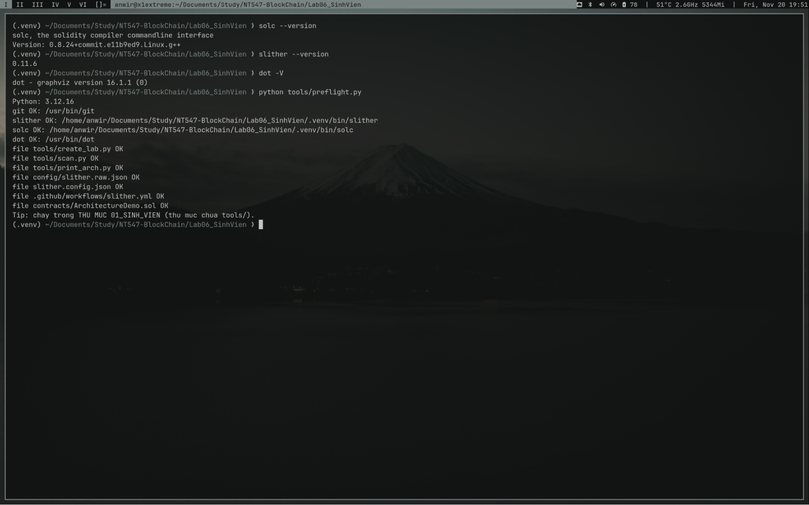

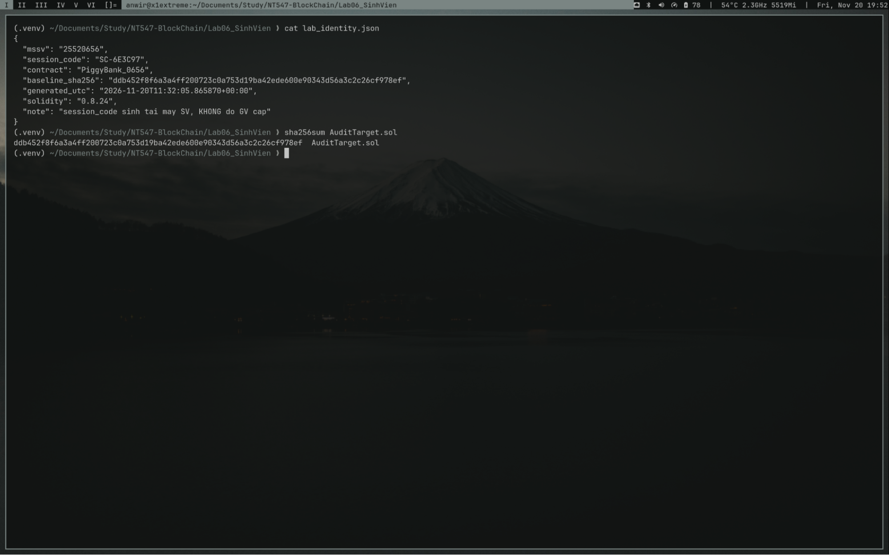

## 1. Static scan (2,0 điểm)

- Lệnh raw: `python tools/scan.py --mode raw --tag before`
- Số lượng finding raw từ `evidence/before_raw/summary.json`:
  - High: 3; Medium: 2; Low: 1; Informational: 5; Optimization: 1 (tổng 12)
- Chạy configured: `python tools/scan.py --mode configured --tag before`
  - High: 3; Medium: 2; Low: 0; Informational: 0; Optimization: 1 (tổng 6)
- So sánh raw/configured: High/Medium giữ nguyên (3/2) khi chỉ đổi config. Config chỉ lọc bỏ Low (1 → 0) và Informational (5 → 0); Optimization giữ nguyên (1 → 1).
- 3 detector **khác tên**: `reentrancy-eth`, `tx-origin`, `uninitialized-state`.

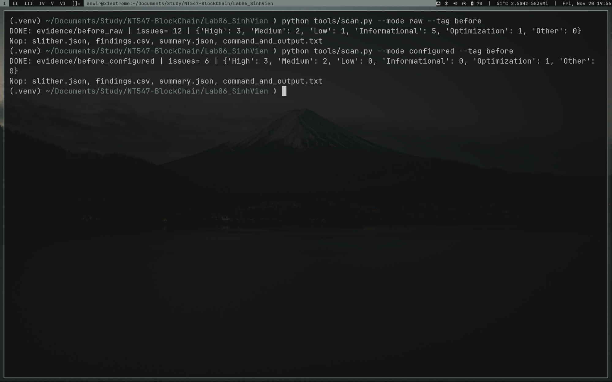

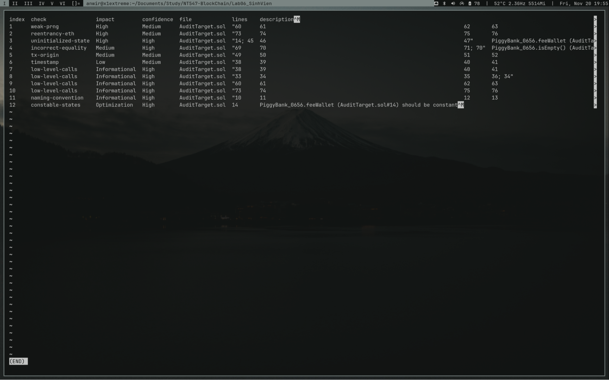

| ID finding | Detector | Impact | Confidence | Source (file:dòng) | Luồng dữ liệu: đầu vào -> thao tác -> tác hại |
|---|---|---|---|---|---|
| F01 | `reentrancy-eth` | High | Medium | AuditTarget.sol:`redeem()`:76–78 | Hợp đồng tấn công đã gửi 1 ETH qua `save()` rồi gọi `redeem()` → dòng 76 gửi ETH **trước** khi dòng 78 đặt `deposits[attacker] = 0`, nên `receive()` của attacker gọi lại `redeem()` và `require(amount > 0)` ở dòng 75 vẫn qua → attacker rút lặp nhiều lần 1 ETH, lấy luôn tiền gửi của người dùng khác. |
| F02 | `tx-origin` | Medium | Medium | AuditTarget.sol:`handOver()`:50 | Owner bị dụ gọi một hàm trên hợp đồng độc hại, hợp đồng này gọi tiếp `handOver(attacker)` → dòng 50 so `tx.origin == owner` (đúng, vì owner khởi tạo giao dịch) thay vì kiểm tra `msg.sender` (đang là hợp đồng độc hại) → dòng 52 gán `owner = attacker`, attacker chiếm toàn quyền và rút sạch tiền qua `ownerWithdraw`. |
| F03 | `uninitialized-state` | High | High | AuditTarget.sol:14 (khai báo), `forwardFees()`:46 (sử dụng) | `feeWallet` không được gán ở đâu (không trong constructor, không có setter), nên mặc định là `address(0)` → owner gọi `forwardFees()`, dòng 46 thực hiện `feeWallet.transfer(address(this).balance / 2)` tới `address(0)` → một nửa số dư (kể cả tiền gửi của người dùng) bị đốt vĩnh viễn, mỗi lần gọi đốt thêm một nửa phần còn lại. |

## 2. Triage và sửa lỗi (2,5 điểm)

Đọc toàn bộ AuditTarget.sol: nhận diện **4 mẫu lỗi thật + 2 đoạn cần đánh giá ngữ cảnh**,
kể cả khi Slither không hiển thị đủ 6 cảnh báo. Với mẫu không có detector,
ghi “Manual review / Not reported”, KHÔNG sửa slither.json hoặc tạo finding giả.

Số dòng trong bảng tính theo bản baseline (commit `0adf075`).

| Detector + vị trí | TP / FP / Chưa kết luận | Bằng chứng kiểm soát/khả năng khai thác | Biện pháp (Fix / Accept có lý do) | Sau sửa |
|---|---|---|---|---|
| `reentrancy-eth` — `redeem()` 73–79 (call dòng 76, ghi state dòng 78) | **TP** | Hàm `external`, không modifier, ai cũng gọi được. State `deposits` được cập nhật **sau** external call, nên hợp đồng nhận ETH có thể gọi lại khi số dư chưa về 0. | **Fix:** Checks-Effects-Interactions, chuyển `deposits[msg.sender] = 0` lên trước `call`. | Hết cảnh báo; chỉ còn `low-level-calls` (Info, accepted) |
| `tx-origin` — `handOver()` dòng 50 | **TP** | Hàm không có modifier, xác thực bằng `tx.origin`; hợp đồng trung gian do owner gọi vào vẫn vượt qua kiểm tra và ghi đè `owner`. | **Fix:** bỏ dòng `tx.origin`, thêm `onlyOwner` (xác thực bằng `msg.sender`). | Hết cảnh báo; còn `events-access` (Low, accepted) |
| `uninitialized-state` — `feeWallet` dòng 14, dùng ở `forwardFees()` dòng 46 | **TP** | Toàn bộ contract không có lệnh gán `feeWallet` → luôn là `address(0)`. Không cần attacker: chính owner gọi `forwardFees()` là mất tiền, giao dịch không revert. | **Fix:** `feeWallet` thành `immutable`, constructor nhận `_feeWallet` và `require(_feeWallet != address(0))`. | Hết cảnh báo; `constable-states` (Optimization) cũng hết |
| `weak-prng` — `settle()` dòng 62 | **TP** | `block.timestamp % players.length` quyết định người nhận **toàn bộ** tiền thưởng; owner tự chọn thời điểm gọi `settle()` nên có thể chọn block cho kết quả mong muốn. | **Fix:** commit-reveal (`openRound(commit, duration)`, `settle(bytes32 seed)`), có hạn bán vé `salesEnd`. Giới hạn: owner biết seed trước nên vẫn có thể mua thêm vé để dò kết quả hoặc không reveal; giải pháp đầy đủ cần nguồn ngẫu nhiên ngoài (Chainlink VRF), vượt phạm vi bài. | Hết cảnh báo; thêm `timestamp` (Low) ở `buyTicket`/`settle`, accepted |
| `incorrect-equality` — `isEmpty()` dòng 70 | **FP theo ngữ cảnh (accepted)** | Hàm `view`, không ghi state, không hàm nào gọi nội bộ. Ép gửi ETH vào contract chỉ làm hàm trả `false`, không ai mất tiền hay quyền. | **Accept:** `// slither-disable-next-line incorrect-equality` đặt ngay trên dòng `return`. | Không còn báo |
| `timestamp` — `releaseTenth()` dòng 39 | **FP theo ngữ cảnh (accepted)** | Chỉ owner gọi; dùng làm khóa thời gian 1 ngày. Sau The Merge timestamp gắn với slot 12 giây, sai lệch vài giây không đáng kể so với 86.400 giây. | **Accept:** không sửa (Low, bị config lọc). | Vẫn báo Low ở raw |
| Manual review / Not reported — `settle()` dòng 65 | **TP** | Người thắng nhận `address(this).balance`, tức lấy luôn tiền tiết kiệm của người dùng `save()`. Slither không báo. | **Fix:** chỉ trả `prize = players.length * 0.01 ether`, tính trước `delete players`. | — |
| Manual review / Not reported — `ownerWithdraw`, `releaseTenth`, `forwardFees` | Ghi nhận (rủi ro tập trung quyền) | Các hàm tính trên `address(this).balance`, nên owner rút được cả tiền gửi của người dùng. | Ghi nhận, không sửa trong phạm vi bài (thuộc thiết kế). | — |

- **Kịch bản khai thác TP (reentrancy):** Attacker triển khai hợp đồng có `receive()`, gửi 1 ETH qua `save()` → gọi `redeem()`; dòng 76 gửi 1 ETH kích hoạt `receive()`, trong đó gọi lại `redeem()` khi `PiggyBank` còn ≥ 1 ETH → vì dòng 78 chưa chạy, `deposits[attacker]` vẫn là 1 ETH nên kiểm tra ở dòng 75 lại qua, lặp đến khi số dư dưới 1 ETH thì dừng (nếu không dừng, `require(ok)` sẽ revert cả giao dịch) → với 1 ETH bỏ vào, attacker rút được toàn bộ tiền của những người gửi khác.
- **Finding có severity cao nhưng risk thực tế không tương ứng:** `incorrect-equality` ở `isEmpty()` (Medium, confidence High). Strict equality với `address(this).balance` chỉ nguy hiểm khi điều khiển logic (ví dụ `require(balance == 0)` để mở khóa chức năng). Ở đây hàm chỉ là `view`, không được hàm nào dùng nội bộ, nên kẻ tấn công ép gửi ETH chỉ làm kết quả hiển thị sai, không ảnh hưởng tiền hay quyền.
- **Bằng chứng `git diff`, scan before/after và cảnh báo còn lại:** diff đầy đủ ở `evidence/fix.diff`. So sánh `before_raw` (12 finding: 3 High, 2 Medium, 1 Low, 5 Informational, 1 Optimization) với `after_raw` (10 finding: 0 High, 0 Medium, 5 Low, 5 Informational, 0 Optimization); `after_configured` còn 0 finding. Các cảnh báo còn lại đều accepted: (1) `timestamp` ở `releaseTenth`, `buyTicket`, `settle` chỉ dùng cho hạn thời gian tính bằng giờ/ngày, không làm nguồn ngẫu nhiên; (2) `events-access` (`handOver`) và `events-maths` (`openRound`) là thiếu event khi đổi state, chỉ ảnh hưởng giám sát off-chain, không khai thác được; (3) `low-level-calls` ở 4 hàm đều kiểm tra kết quả bằng `require(ok)`, `redeem` đã theo CEI, các hàm còn lại có `onlyOwner`, và dùng `call` thay `transfer` để tránh giới hạn 2300 gas; (4) `naming-convention` do tên contract được generator sinh theo MSSV.
- **Lý do của mọi `slither-disable-next-line`:** chỉ có một suppression, detector `incorrect-equality`, đặt ngay trên dòng `return address(this).balance == 0;` trong `isEmpty()`. Kiểm soát bù trừ: hàm là `view`, không được dùng làm điều kiện ở bất kỳ hàm ghi state nào; nếu sau này có hàm dùng `isEmpty()` để ra quyết định thì phải gỡ suppression và đổi logic.

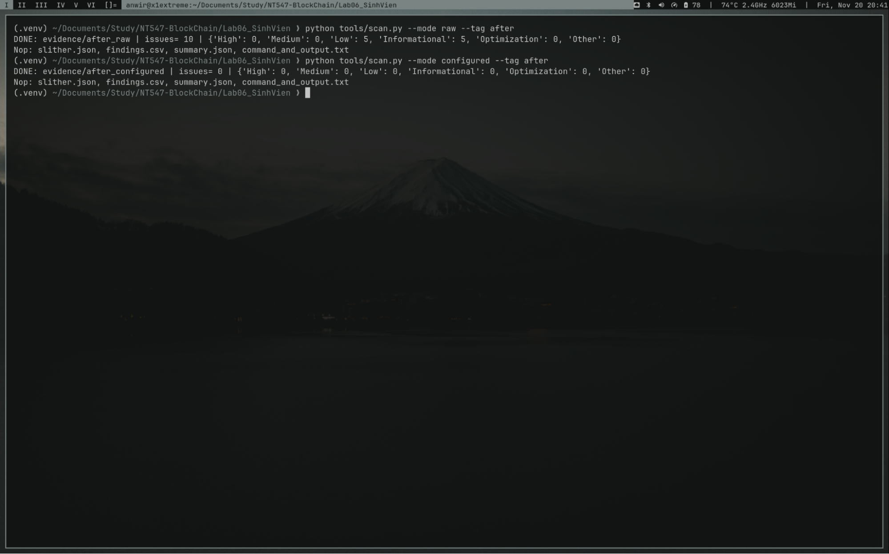

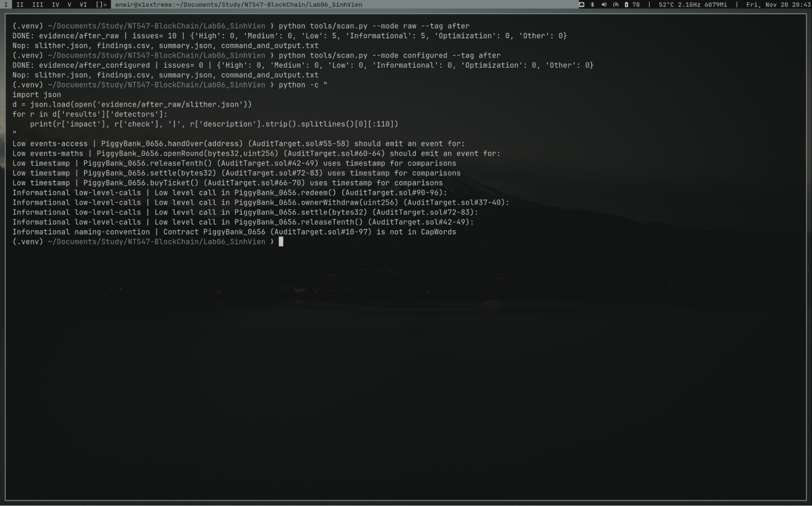

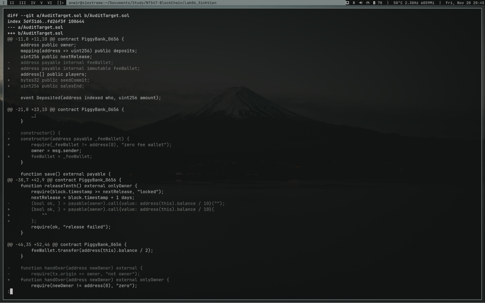

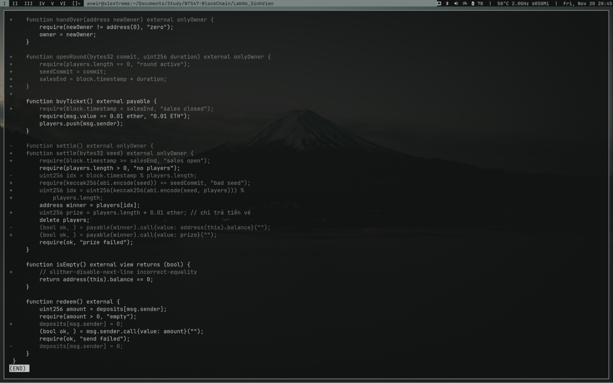

## 3. Kiến trúc / Inheritance (1,5 điểm)

- Lệnh printer đã chạy: `python tools/print_arch.py`. Script sinh `human_summary.txt` nhưng báo không tìm thấy `*.dot`. Đọc `printer_log.txt` thấy Slither 0.11.6 ghi inheritance graph tại `contracts/ArchitectureDemo.sol.inheritance-graph.dot` (cạnh file nguồn) thay vì thư mục evidence. Đã chuyển file về `evidence/architecture/ArchitectureDemo.sol.dot` và render bằng `dot -Tpng evidence/architecture/ArchitectureDemo.sol.dot -o evidence/architecture/inheritance.png` theo hướng dẫn mục 6.
- Ảnh `evidence/architecture/inheritance.png` (bản đã đánh dấu: `inheritance_marked.png`):

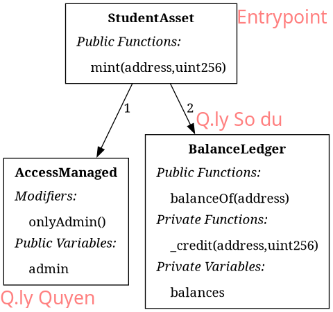

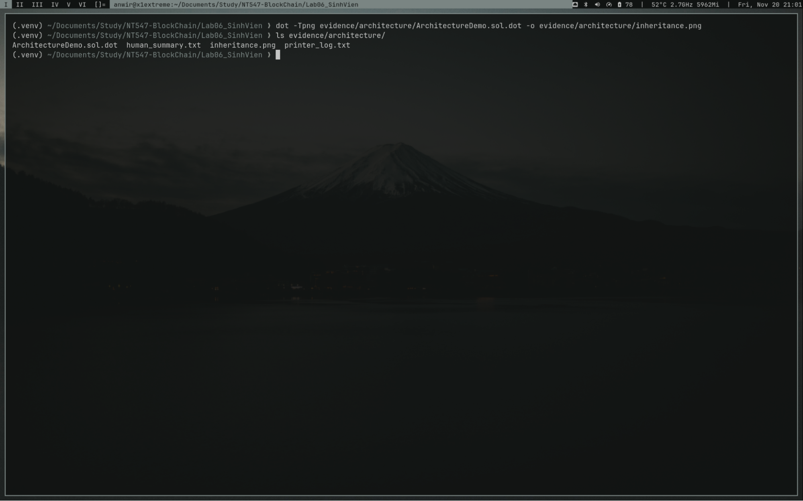

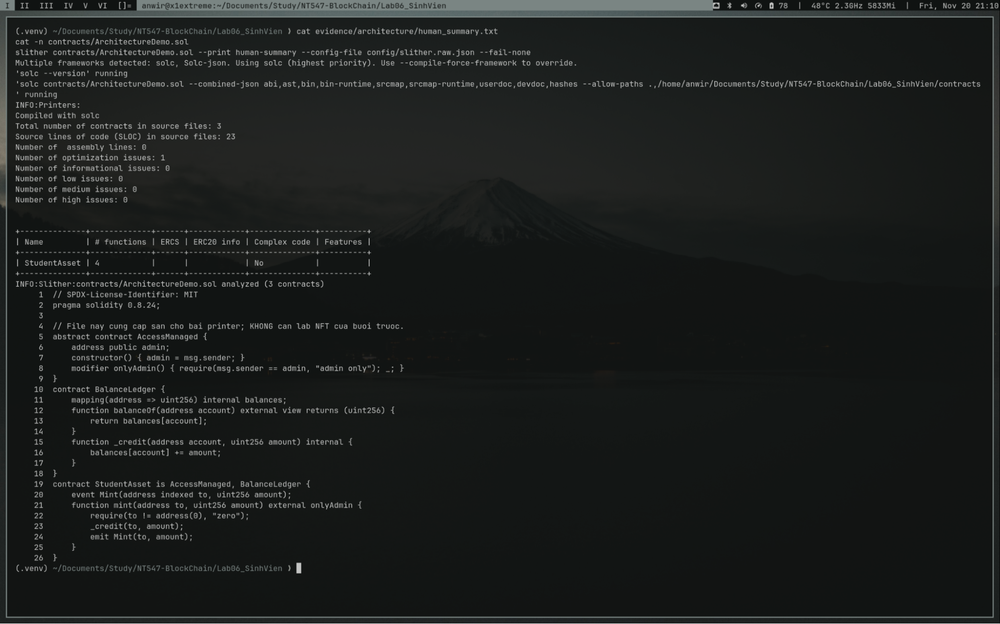

- Access control nằm ở **AccessManaged** (`admin`, `onlyAdmin`); logic số dư nằm ở **BalanceLedger** (`balances`, `balanceOf`, `_credit`); contract triển khai nằm ở **StudentAsset** (entrypoint `mint`).
- Giải thích 3–5 câu điểm audit cần bắt đầu: Logic bảo mật trọng yếu của hệ thống nằm ở hai contract cha thay vì `StudentAsset`: `AccessManaged` (phân quyền qua `admin` và `onlyAdmin`) và `BalanceLedger` (chứa `_credit`, điểm ghi duy nhất vào `balances`). Vì `StudentAsset.mint(address,uint256)` (`external`, có `onlyAdmin`) là entrypoint thay đổi state duy nhất (còn `balanceOf` chỉ là `view`), quá trình audit cần bắt đầu từ `mint` và truy vết ngược theo chuỗi kế thừa xuống `onlyAdmin` cùng `_credit`. Nếu chỉ đánh giá riêng `StudentAsset`, auditor sẽ bỏ sót các rủi ro cốt lõi: sai sót trong `onlyAdmin` (như dùng `tx.origin` ở Nhiệm vụ 5) sẽ ảnh hưởng dây chuyền đến mọi hàm dùng modifier này, còn `_credit` không tự kiểm tra quyền nên bất kỳ hàm con nào gọi nó mà thiếu `onlyAdmin` đều trở thành lỗ hổng tăng số dư trái phép. Ngoài ra, do `admin` chỉ được gán một lần trong constructor và không có cơ chế chuyển quyền, việc thất lạc khóa admin sẽ làm tê liệt vĩnh viễn chức năng `mint` — một rủi ro vận hành cần được ghi nhận.

## 4. Red -> Green CI (2,5 điểm)

| Phase | Commit (full/short SHA) | Run URL | Kết quả | Detector khiến RED / lý do GREEN |
|---|---|---|---|---|
| Baseline vulnerable | `0adf075760bcfa8462db293a7d4b834a3d1db59b` | https://github.com/Anwiralone4ev/NT547-Lab06/actions/runs/44742247443 | RED | `weak-prng`, `reentrancy-eth`, `uninitialized-state` (High); `incorrect-equality`, `tx-origin` (Medium); log: `6 result(s) found` |
| Patched | `39ac039b979a8ac05aac1aaba7bb2fc2b32bfa59` | https://github.com/Anwiralone4ev/NT547-Lab06/actions/runs/44747423786 | GREEN | 4 TP đã sửa, `incorrect-equality` suppress có lý do; log: `0 result(s) found` |

- So sánh local `--fail-none` (thu thập findings) với CI `fail-on: medium`: cả hai dùng cùng cấu hình và cho cùng kết quả ở baseline (6 finding với `slither.config.json`). Ở local, `--fail-none` luôn trả exit code 0 để lưu đủ bằng chứng (JSON/CSV), nên exit code 0 không có nghĩa contract an toàn. Ở CI, `fail-on: medium` làm job thất bại khi có finding từ Medium trở lên. Nói cách khác, cùng một kết quả phân tích, chỉ khác chính sách xử lý.
- `exclude_low/informational` thay đổi kết quả hiển thị ra sao: bật lọc giúp giảm nhiễu (before: 12 → 6 finding, after: 10 → 0), còn High/Medium không bị ảnh hưởng nên quality gate vẫn chặn đúng lỗi nghiêm trọng. Nhược điểm là các cảnh báo Low như `timestamp` không hiện trên CI, nên khi triage vẫn phải xem bản raw.

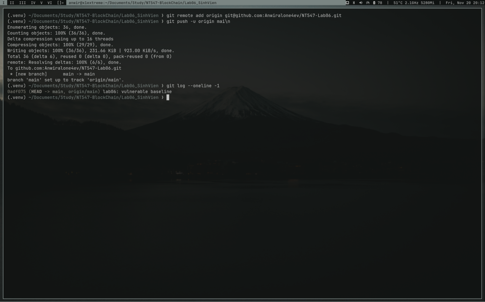

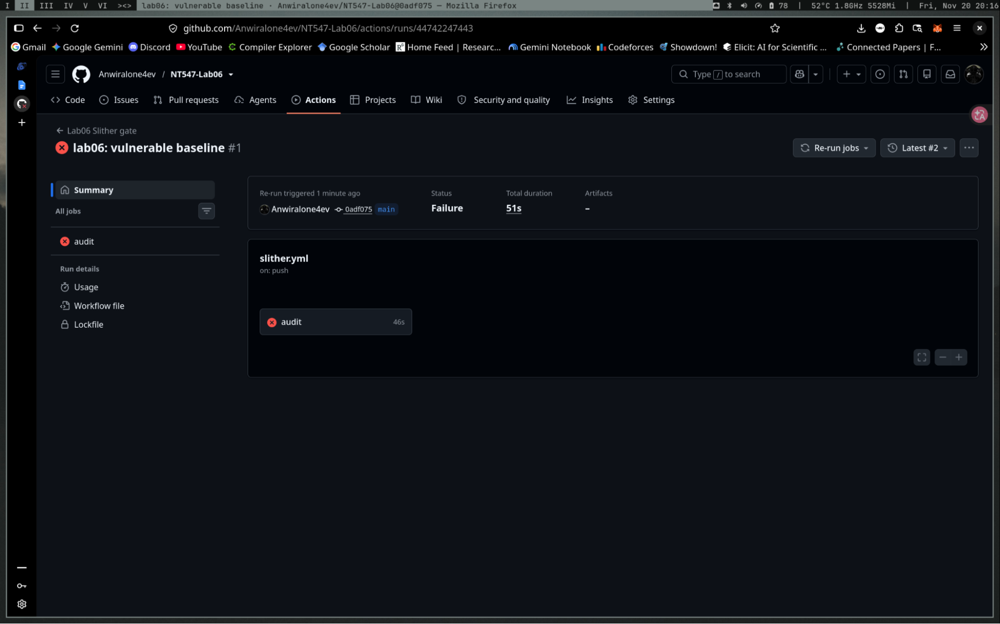

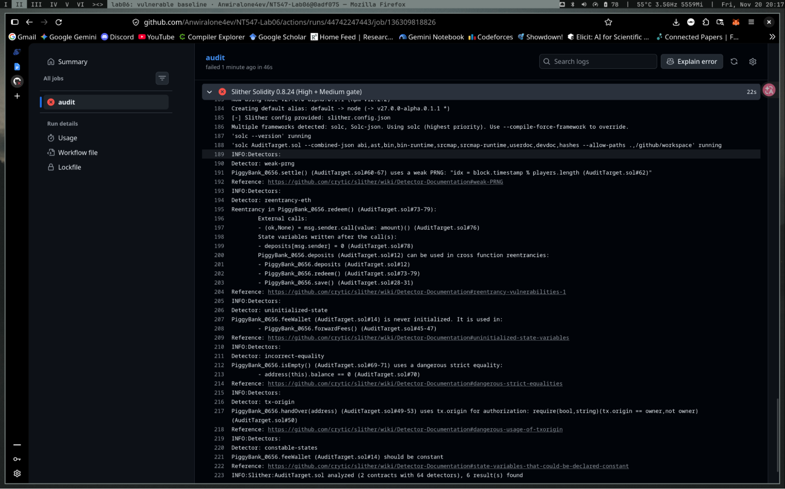

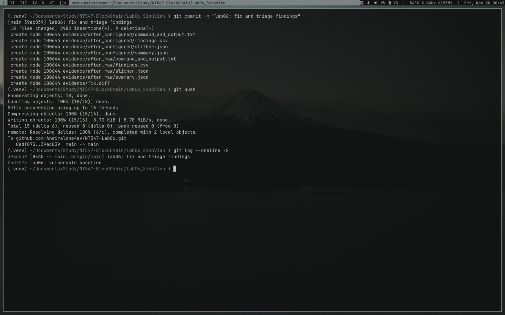

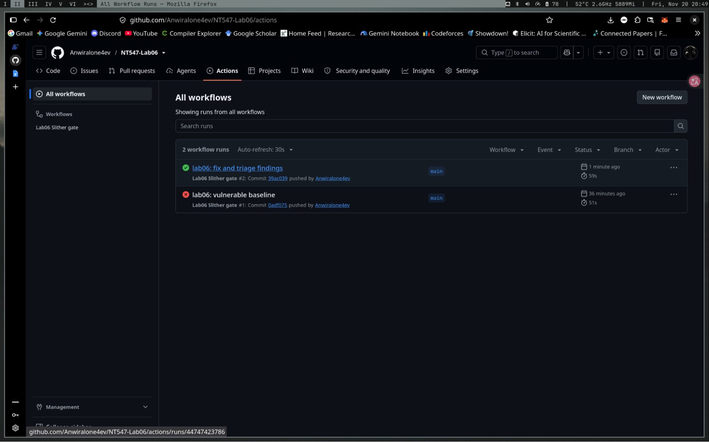

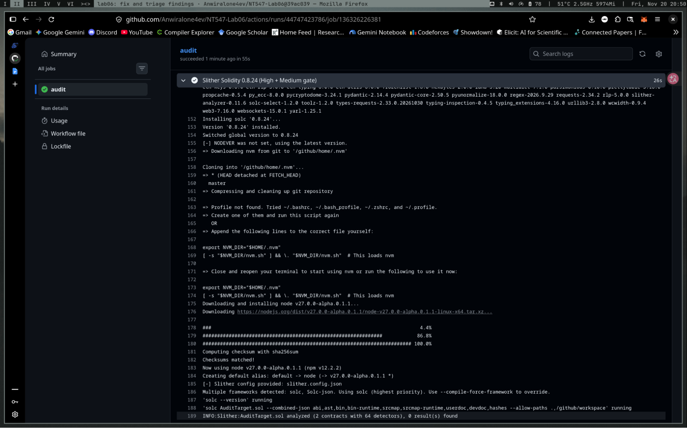

## 5. Mutation RED -> GREEN (1,5 điểm)

- Mutation một dòng: `require(msg.sender == owner, "not owner")` -> `require(tx.origin == owner, "not owner")` trong `modifier onlyOwner` (dòng 22 của bản đã sửa). `git show --stat` xác nhận `1 file changed, 1 insertion(+), 1 deletion(-)`.
- Detector kỳ vọng: `tx-origin` (mức Medium); xác nhận của em từ CI: **CI GREEN, không như kỳ vọng RED** (run #3, commit `da70bd8`). Chạy cục bộ `slither AuditTarget.sol --detect tx-origin` trên bản mutation cũng cho `0 result(s) found`. Đọc mã nguồn detector `slither/detectors/statements/tx_origin.py` (dòng 65: `for f in contract.functions:`) cho thấy detector chỉ duyệt các hàm, không duyệt modifier, nên `tx.origin` nằm trong `onlyOwner` không được phát hiện. Ở baseline, `tx.origin` nằm trực tiếp trong hàm `handOver()` nên bị bắt. Đây là false negative của Slither 0.11.6.

| Phase | Commit SHA | Run URL | Kết quả |
|---|---|---|---|
| Mutation | `da70bd81dad7f8b3ad1daafe6321c0e3e72477d7` | https://github.com/Anwiralone4ev/NT547-Lab06/actions/runs/44753214958 | GREEN (kỳ vọng RED — false negative, xem phân tích) |
| Revert mutation | '1c2d2f75bee0cba295ce5683311449ec00b79f75' | https://github.com/Anwiralone4ev/NT547-Lab06/actions/runs/44755405434 | GREEN |

- Giải thích sự thay đổi về nguồn định danh/authorization: Trước mutation, `onlyOwner` xác thực bằng `msg.sender`, tức người gọi trực tiếp; sau mutation, nó xác thực bằng `tx.origin`, tức ví EOA khởi tạo giao dịch. Nếu owner bị dụ gọi một hợp đồng độc hại, hợp đồng đó có thể gọi bất kỳ hàm nào có `onlyOwner` (6 hàm: `ownerWithdraw`, `releaseTenth`, `forwardFees`, `handOver`, `openRound`, `settle`) và vượt qua kiểm tra vì `tx.origin` vẫn là owner. Mức ảnh hưởng còn rộng hơn lỗi ở baseline vì modifier bảo vệ toàn bộ chức năng quản trị. Việc quality gate vẫn GREEN cho thấy CI dựa trên phân tích tĩnh chỉ là một lớp phòng thủ: không thay thế được review thủ công, và nên kết hợp thêm công cụ khác (ví dụ rule `avoid-tx-origin` của solhint) hoặc viết detector tùy chỉnh có duyệt cả modifier.

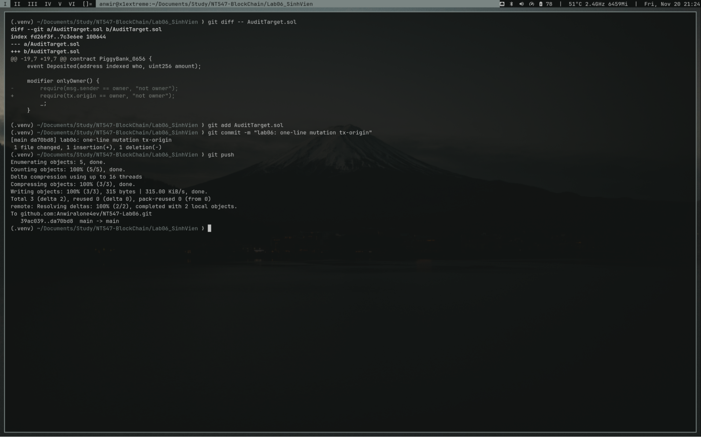

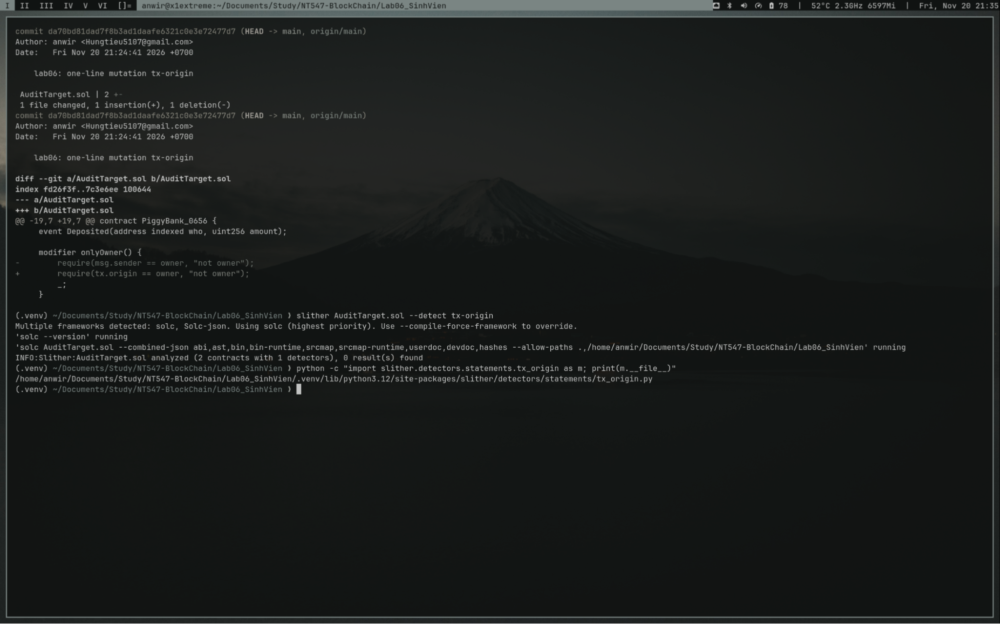

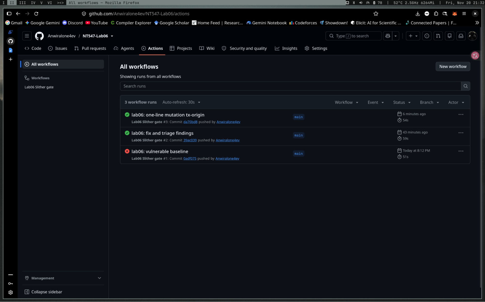

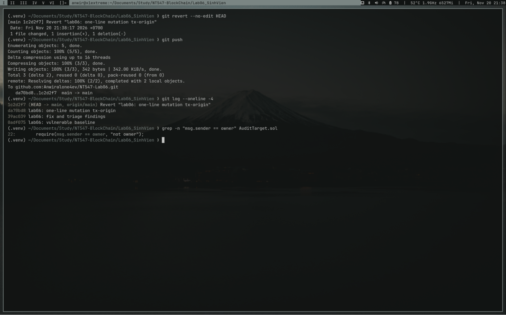

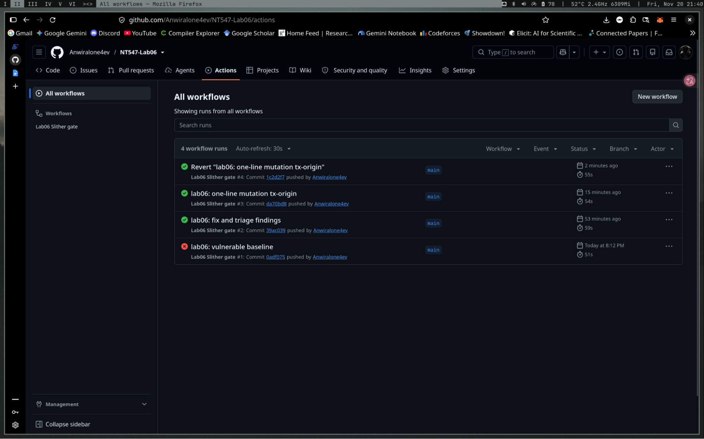

## 6. Bằng chứng, tự kiểm

- [x] `AuditTarget.sol`, `lab_identity.json`
- [x] `evidence/before_raw/` và `evidence/before_configured/`
- [x] `evidence/after_raw/` và `evidence/after_configured/`
- [x] `evidence/architecture/`
- [x] 04 URL Actions run + 04 commit SHA (thực tế RED/GREEN/GREEN/GREEN, run #3 giải thích ở mục 5)
- [x] Link repo và ảnh màn hình có terminal / URL / commit SHA; không cắt mất ngữ cảnh
- [x] Các finding được triage, không chép lại mô tả detector thay cho suy luận
- [x] Tuyệt đối không có seed phrase, private key, credentials

**Nhận xét cuối cùng (5–7 câu):** Bài thực hành cho thấy Slither là công cụ hữu ích để phát hiện nhanh các mẫu lỗi phổ biến, nhưng kết quả của nó cần được triage theo ngữ cảnh chứ không thể dùng như một "máy phán quyết". Có finding được báo Medium nhưng không khai thác được (`incorrect-equality` ở hàm `view`), trong khi có lỗi thật mà công cụ không báo (`settle()` trả toàn bộ số dư, gồm cả tiền tiết kiệm của người dùng). Việc sửa lỗi cũng cần cân nhắc tác động phụ: giải pháp commit-reveal loại bỏ phụ thuộc vào timestamp nhưng vẫn còn giới hạn vì owner biết seed. Quy trình RED → GREEN trên GitHub Actions giúp biến phân tích tĩnh thành quality gate tự động, ngăn mã có lỗi Medium/High được merge. Tuy nhiên thí nghiệm mutation cho thấy gate này có false negative: `tx.origin` đặt trong modifier không bị detector phát hiện, nên CI vẫn GREEN dù lỗ hổng ảnh hưởng toàn bộ chức năng quản trị. Vì vậy CI chỉ nên là một lớp trong chiến lược phòng thủ nhiều lớp, kết hợp review thủ công, nhiều công cụ phân tích và kiểm thử.
